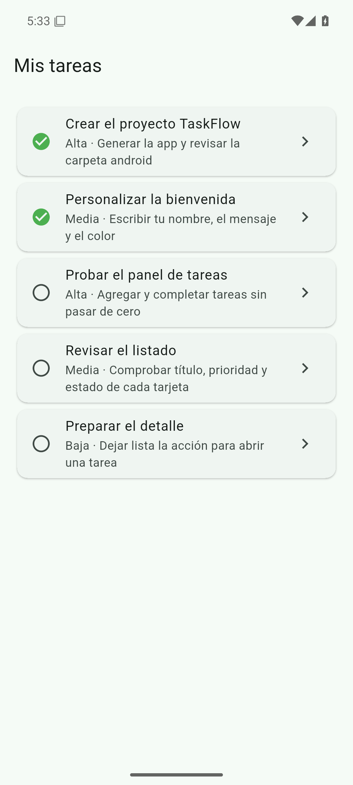
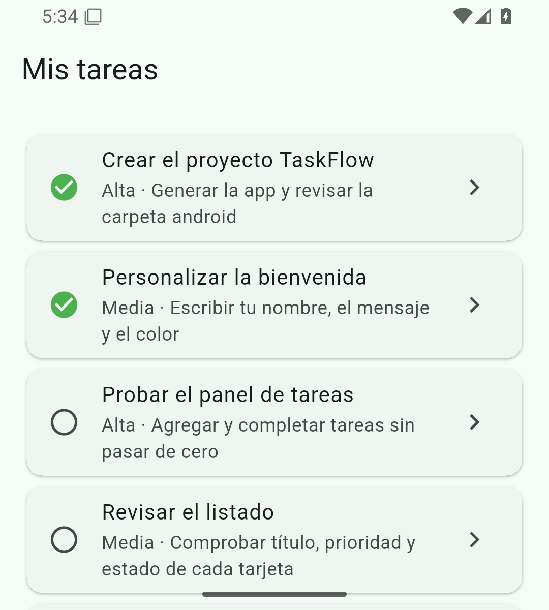
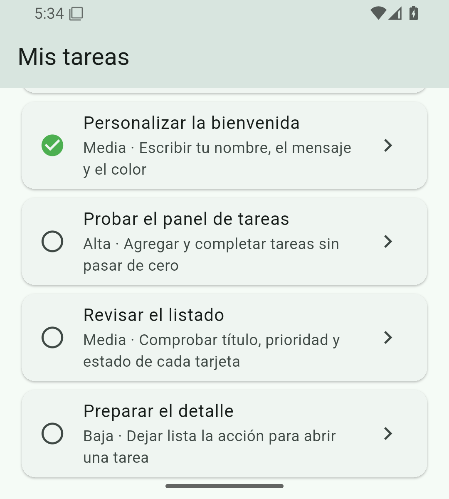

# TaskFlow

App de tareas del curso de Flutter. En esta versión la pantalla principal es un listado local de cinco tareas. La guía de la sesión sigue en [LEEME.md](LEEME.md). La procedencia de las capturas está en [EVIDENCIAS.md](EVIDENCIAS.md).

**Autora:** Mildreth Guanoluisa

## Objetivo

Mostrar, en una sola pantalla, las tareas de demostración de este proyecto: título, prioridad, descripción y si ya están completadas. Cada tarjeta incluye una señal visual de detalle. Esa pantalla de detalle todavía no existe.

## Qué hace la app

Todo el código de la interfaz está en `lib/main.dart`.

- `Task` guarda `id`, `title`, `description`, `priority` e `isCompleted`.
- `demoTasks` define cinco tareas de este proyecto.
- `TaskCard` pinta cada tarea. El subtítulo junta la prioridad y la descripción con `'${task.priority} · ${task.description}'`. Si `isCompleted` es verdadero, el ícono es `Icons.check_circle` en verde; si es falso, es `Icons.radio_button_unchecked`.
- `TaskListScreen` muestra la barra «Mis tareas» y un `ListView.builder` que crea una `TaskCard` por elemento de `demoTasks`.
- El `Icons.chevron_right` de cada tarjeta es la acción visual de detalle. `TaskCard` no define `onTap` ni una ruta: el chevron no abre otra pantalla.

`TaskFlowApp` usa Material 3 y `ColorScheme.fromSeed` con el color `0xFF1F6F5B`. El título de la aplicación es TaskFlow.

| Id | Título | Prioridad | Completada |
| --- | --- | --- | --- |
| 1 | Crear el proyecto TaskFlow | Alta | sí |
| 2 | Personalizar la bienvenida | Media | sí |
| 3 | Probar el panel de tareas | Alta | no |
| 4 | Revisar el listado | Media | no |
| 5 | Preparar el detalle | Baja | no |

## Requisitos

Tomados de `pubspec.yaml` y `pubspec.lock`:

- Dart `>=3.13.7 <4.0.0` (`environment.sdk: ^3.13.7`)
- Flutter `>=3.18.0-18.0.pre.54` (restricción del lockfile)
- Dependencia `flutter` (SDK)
- Dependencia `cupertino_icons: ^1.0.8`
- Desarrollo: `flutter_test` (SDK) y `flutter_lints: ^6.0.0`

El paquete no se publica en pub.dev (`publish_to: none`). La versión de la app es `1.0.0+1`.

## Ejecutar y probar

```bash
flutter pub get
flutter run
```

Comandos de comprobación que ya documenta [LEEME.md](LEEME.md):

```bash
dart format lib
flutter analyze
flutter test
```

`flutter test` ejecuta las dos pruebas que hay en `test/widget_test.dart`:

- `el listado muestra cinco tareas con su estado`
- `la lista se desplaza hasta la última tarea`

## Estructura

```text
lib/main.dart                 listado, modelo Task y TaskCard
test/widget_test.dart         pruebas del listado
pubspec.yaml                  nombre, SDK y dependencias
LEEME.md                      guía de la sesión 3
EVIDENCIAS.md                 procedencia de las capturas
docs/evidencias/              PNG del emulador y sesion-03-ejecucion.mp4
android/ ios/ linux/ macos/ web/ windows/   plataformas del proyecto Flutter
```

## Capturas

Emulador remoto Android 15 (API 35), AVD `taskflow_api35`, con Flutter 3.47.9. Son capturas reales de ese emulador. El detalle de tamaños y el SHA de `main` usado para generarlas están en [EVIDENCIAS.md](EVIDENCIAS.md).

### Listado completo (1080×2400)

Pantalla completa del AVD. Las cinco tarjetas se ven a la vez: dos completadas, con el ícono verde, y tres pendientes.



### Antes de desplazar (1080×1200)

La ventana del emulador está en 1080×1200. Se ve la parte de arriba del listado, desde «Crear el proyecto TaskFlow» hasta «Revisar el listado», cortada en el borde inferior. «Preparar el detalle» queda fuera.



### Después de desplazar (1080×1200)

La misma ventana de 1080×1200, después del desplazamiento. «Crear el proyecto TaskFlow» ya no está en pantalla y aparece «Preparar el detalle».



## Recorrido

[sesion-03-ejecucion.mp4](docs/evidencias/sesion-03-ejecucion.mp4)

Grabación de 16 s en H.264. La ventana útil del emulador es 1080×1200 y el fotograma del archivo es 1080×2400, con bandas negras. El recorrido muestra el listado de cinco tareas, dos con ícono verde, el desplazamiento hasta «Preparar el detalle» y el regreso al inicio. La procedencia está en [EVIDENCIAS.md](EVIDENCIAS.md).
